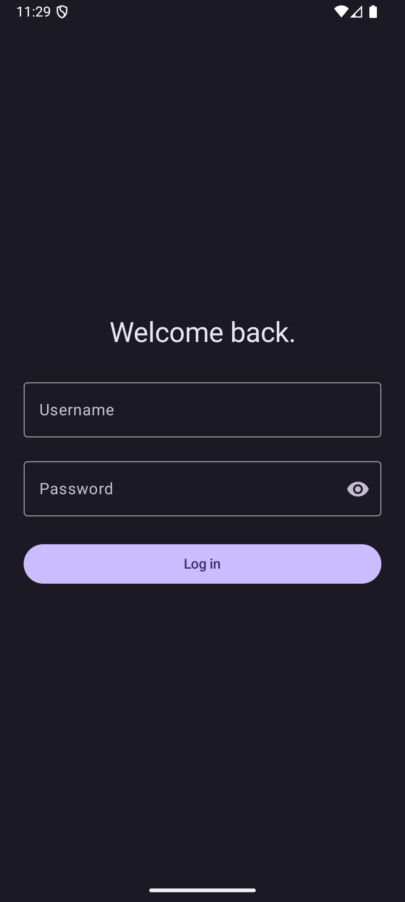
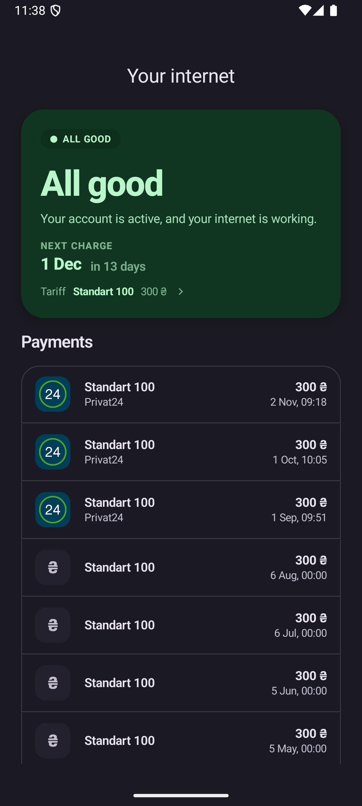
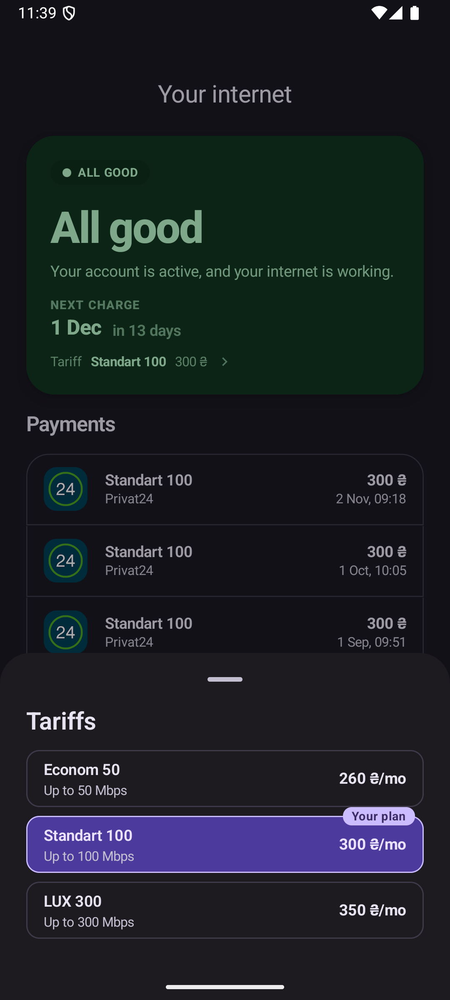
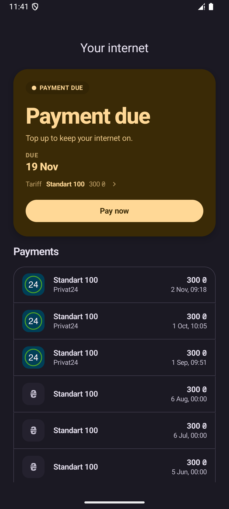
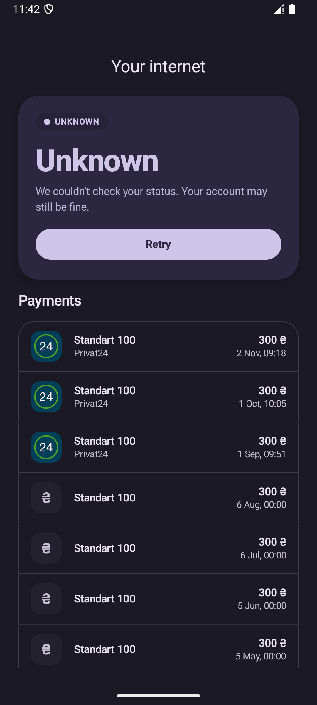
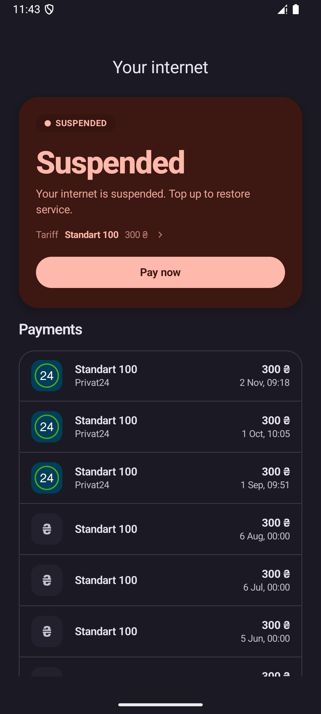

# MyKompot

MyKompot is an unofficial Android client for the [Kompot](https://kompot.uz.ua) ISP customer portal. It lets you sign in, check account status and tariff details, review payment history, open payment methods, and receive payment/session reminders.

## Screenshots

<p align="center">
  
  
  
</p>
<p align="center">
  
  
  
</p>

## Features

- **Sign in** to your Kompot portal account
- **Account status** at a glance (active, payment due, or suspended) with next payment info
- **Tariff details** and available plans
- **Payments history** with pagination and pull-to-refresh
- **Quick payment actions** (Privat24, monobank, EasyPay)
- **Reminders & notifications** for upcoming/overdue payments and expired sessions (with permission)
- **Cached/offline-friendly data** with refresh from the portal when available

## Tech stack

- Kotlin, Jetpack Compose, Material 3
- Koin (DI)
- Retrofit + Kspoon (HTML scraping/parsing)
- DataStore (local persistence)
- WorkManager (background/session and reminder scheduling)

## Build

**Requirements:** Android SDK, JDK 21, and a recent Android Studio / Gradle setup.

```bash
# Debug APK (uses local mock endpoints by default)
./gradlew assembleDebug

# Unit tests and static checks
./gradlew spotlessApply detekt :app:testDebugUnitTest
```

### Release build

Release builds target the real portal endpoints configured in `app/build.gradle.kts`.

To produce a signed release APK, provide signing credentials via `keystore.properties` (gitignored) or environment variables (`storeFile`, `storePassword`, `keyAlias`, `keyPassword`):

```properties
# keystore.properties (do not commit)
storeFile=keystore/release.jks
storePassword=...
keyAlias=...
keyPassword=...
```

```bash
./gradlew assembleRelease
# Output: app/build/outputs/apk/release/app-release.apk
```

## Notes

- This is an unofficial project and is not affiliated with Kompot.
